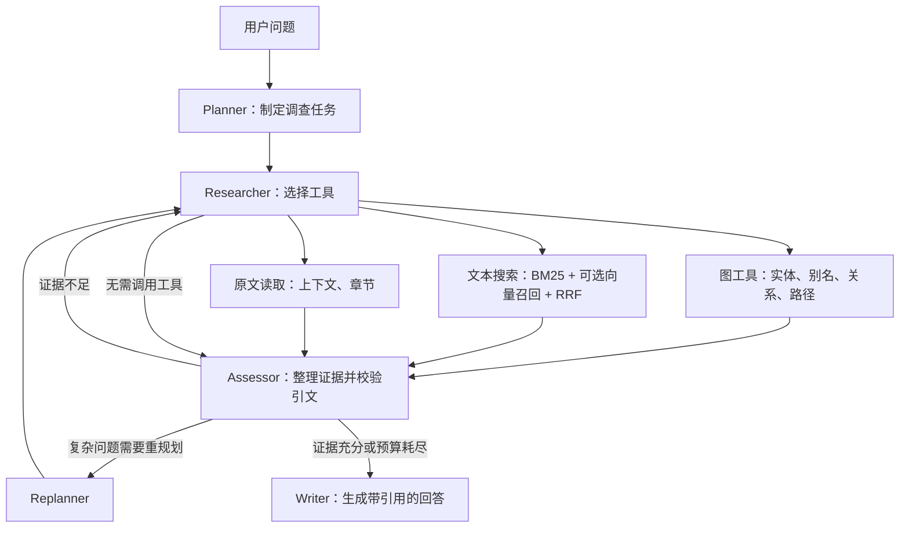

# Novel Agent

基于 LangGraph 的小说长文本分析 Agent。上传 TXT、提出问题后，系统会规划调查任务，通过原文和知识图谱收集证据，校验引文，再生成附带章节、文本块与行号的回答。

Web 工作台支持小说管理、多轮会话、章节浏览、文本检索、知识图谱，以及 Agent 执行过程和模型用量的实时查看。


## 导航

- [快速开始](#快速开始)
- [问答与检索机制](#问答与检索机制)
- [图知识库](#图知识库)
- [配置参考](#配置参考)
- [运行与故障恢复](#运行与故障恢复)
- [数据存储与外部请求](#数据存储与外部请求)
- [开发与验证](#开发与验证)
- [能力边界](#能力边界)

## 快速开始

### 1. 安装依赖

在项目根目录操作。需要 Python 3.11+，以及 Node.js 20.19.x 或 22.12+ 与 npm（Vite 7 的要求；仅使用后端 API 时可省略前端依赖）。

```powershell
python -m pip install -e ".[dev]"
Set-Location frontend
npm install
Set-Location ..
Copy-Item .env.example .env
```

以上复制命令用于首次配置；已有 `.env` 时直接编辑该文件。

### 2. 配置聊天模型

在 `.env` 中填写凭据和模型名称：

```dotenv
OPENAI_API_KEY=your-key
MODEL_NAME=gpt-4.1-mini
```

使用其他 OpenAI-compatible 服务时，设置 `OPENAI_BASE_URL`。模型需要支持 Tool Calling、通过工具调用返回结构化对象，以及足够长的上下文。部分模型的思考模式与 named `tool_choice` 不兼容，可设置 `MODEL_THINKING_MODE=disabled`。完整参数见[配置参考](#配置参考)。

### 3. 启动并使用

```powershell
python .\start_dev.py
```

浏览器访问 <http://127.0.0.1:5173>；后端位于 <http://127.0.0.1:8000>，API 文档位于 <http://127.0.0.1:8000/docs>。Linux 使用 `python3 start_dev.py`。按 `Ctrl+C` 停止前后端，仅检查依赖可运行 `python start_dev.py --check`。

1. 上传 `.txt` 小说，查看解析出的章节和正文块。支持常见中文编码，单文件上限为 50 MiB。
2. 在“小说问答”中直接提问，首次发送时自动新建会话；追问使用最近 10 个成功轮次的问题和最终答案作为上下文。
3. 在“章节目录”和“原文检索”中浏览章节、查找片段、展开原文。
4. 需要语义召回时，配置 Embedding 并在“检索设置”中为当前小说开启语义索引。
5. 需要实体关系浏览和图检索时，进入“关系图谱”手动构建图谱。

工作台通过侧栏切换书架、问答、目录、检索、图谱和设置，各页面支持独立的 `#/...` 地址及浏览器前进/后退。问答中的对话、分析过程、原文依据和用量诊断分开展示；切换页面时保留当前任务和输入草稿。

Embedding 与知识图谱是独立的可选能力；仅配置聊天模型即可使用基于 BM25 的问答。

## 问答与检索机制

### Agent 调查流程



简单事实问题使用本地单任务计划，复杂问题由 Planner 拆成最多 3 个调查任务。Researcher 根据任务和证据缺口选择工具；Assessor 提取证据、更新任务状态并决定下一步。模型提交的引文必须通过原文逐字校验，Writer 使用已验证材料回答。

默认每轮最多调用 2 个工具、每个任务最多调查 2 轮并保留 6 条证据，最多重规划 2 次。默认调查步数为 16，接口允许 1–100；步数统计 Researcher 回合。重复调用保护和任务预算限制循环，预算耗尽时会披露未解决项。

### 三种检索如何配合

| 检索方式 | 实现 | 启用条件 |
|---|---|---|
| 关键词检索 | 在约 500 字的 Passage 上执行中文 BM25，叠加原词和章节标题匹配加分 | 上传解析后即可使用 |
| 向量检索 | 将查询编码为向量，与正文片段计算余弦相似度 | 当前小说已启用 Embedding 且索引就绪 |
| 图检索 | 按名称或别名定位实体，在 SQLite 中遍历邻居和路径，返回原文证据 | 当前小说有已发布图谱，且 Agent 选择调用图工具 |

一次 `search_novel` 调用内部，关键词和向量各召回最多 30 个片段，用 RRF 累加 `1 / (60 + 排名)` 融合结果，再按正文块去重并优先分散章节。默认返回 3 条、最多 8 条。向量未启用、构建中或查询失败时使用 BM25 结果。

图工具与文本搜索由 Researcher 按需选择，在 Assessor 的证据审查阶段汇合。当前没有三路统一重排器，也不强制每次问答都查询图谱。图谱返回的别名可由 Agent 用于补充文本搜索，程序不会自动展开所有别名。

例如询问“甲和乙有什么联系”，Agent 可以先定位实体、查询关系或路径，再搜索相关名称和事件、展开原文。人物成长或关系变化问题还需要不同阶段的原文证据；多跳连通本身不能推导出新的事实关系。

### Agent 可用工具

| 工具 | 作用与限制 |
|---|---|
| `get_book_structure` | 查看结构总览；可分页读取章节，每页最多 20 条 |
| `search_novel` | BM25 与可选向量混合搜索，默认 3 条、最多 8 条 |
| `read_context` | 默认读取指定 Chunk，最多附带前后各 1 个 Chunk |
| `read_section` | 按章节读取连续 Chunk，默认 2 个、最多 3 个 |
| `search_graph_entities` | 按主名称或别名找实体，默认 5 条、最多 8 条 |
| `get_graph_entity` | 查看主名称、全部已收录别名及前 8 处原文提及 |
| `get_graph_relations` | 展开最多 2 跳关系，最多 20 个节点、20 条边 |
| `find_graph_paths` | 查两个实体间最多 3 跳、3 条最短关联路径 |

前四个工具始终可用，后四个仅在本轮捕获到可用图谱时注册。工具限定在当前小说内，只读访问数据；图工具输出设有 12000 字符预算，并标记截断结果。

## 图知识库

图知识库是从小说正文派生的独立索引，由实体、别名、语义关系和原文证据组成。使用本地 SQLite，无需额外数据库服务，也不依赖 Embedding。构建复用当前聊天模型配置；浏览和查询已发布图谱时不调用模型。

### 构建流程

在“知识图谱”页点击“构建图谱”后，后台依次执行：

1. **划分窗口**：沿用现有正文块，每个抽取窗口正文最多 2500 字，前后各带最多 300 字上下文。
2. **模型抽取**：提取人物、地点、组织、物品、功法、专有概念，以及师徒、亲属、隶属、敌对、持有、使用等关系和身份线索。
3. **原文校验**：逐字定位名称与证据，补齐章节、Chunk、行号和字符偏移，过滤无效锚点、关系类型及端点。
4. **实体归并**：处理重复提及、同名消歧与明确别名线索，将局部关系映射到统一实体，合并重复关系的证据。
5. **保存发布**：写入暂存版本，检查批次、外键和证据完整性后原子发布。

构建会分批向聊天模型发送正文，页面显示进度、请求数和已报告的 token 用量；供应商未返回的用量标为未知。当前全局同时执行一个图谱构建任务，其他小说排队；图谱构建与 Agent 问答使用独立任务管理。

### 多名称与同名实体

- 全名、简称、别名、绰号和尊号在原文有明确身份依据时可归并。例如原文明示“孙悟空”“悟空”“孙大圣”“齐天大圣”为同一人后，可用任一已收录名称查到该实体，并查看其他名称。
- 先分别出现、后文才确认身份的名称，会在身份核对阶段合并其早期提及和关系。
- 同书、同名、同类型仅有一个候选时优先复用；“不确定”或没有异人依据的“新建”结果不会直接生成副本。另建同名实体需要模型引用原文中的区分依据，多个已知同名身份仍需消歧。
- 消歧优先使用最近的剧情上下文，并保留早期身份锚点；不同名称、泛化称谓和假冒身份不因相似度而归并。

### 浏览与问答

页面支持实体与别名搜索、最多 3 跳的邻居与最短路径、章节及类型过滤。点击关系可查看证据并展开原文。搜索优先主名称精确匹配、别名精确匹配，再到前缀和包含匹配；图遍历设有跳数、数量和时间预算。

关系区分肯定与否认、叙述与人物说法。路径查询使用肯定关系，人物说法仍需结合原文审查。未找到路径，只表示在当前图谱、范围和预算内未找到，不能断言原文中没有联系。

问答每轮开始时固定图谱版本。期间发布新版本不会改变本轮所读版本；未构建或图谱不可用时，问答继续使用文本工具。

### 停止、继续与重建

| 操作或状态 | 行为 |
|---|---|
| 停止 | 在请求边界检查停止标记，保存已完成结果 |
| 继续构建 | 复用抽取与归并检查点，要求正文、模型及规则等构建指纹一致 |
| 服务重启 | 未完成任务标记为停止，需手动继续；不会自动发送正文或调用模型 |
| 重建 | 创建暂存版本，旧图谱继续可查，完成后整体发布；历史版本保留 |
| 规则或模型变化 | 已发布图谱仍可读；旧任务指纹不匹配时需重建，新规则在新生成结果中生效 |

输出截断时切换精简抽取，由模型引用片段编号、程序补齐引文与位置，并按需拆分窗口，最小核心片段为 200 字。较大窗口超时也会拆分，较小窗口及消歧请求执行有限超时重试。

成功解析的候选先缓存，后续本地处理失败后可继续复用；未通过校验的候选不开放查询。最小窗口完整返回时保留全部有效候选，并提示候选密集。详细策略见[技术设计与接口](docs/novel-knowledge-graph-design.md)。图谱 API 前缀为 `/api/novels/{novel_id}/graph`，可在运行中的 `/docs` 查看。

## 配置参考

配置从 `.env` 或进程环境变量读取，模板见 [.env.example](.env.example)。下表为未设置对应环境变量时的代码默认值。

### 聊天模型与调查预算

| 变量 | 默认值 | 说明 |
|---|---|---|
| `OPENAI_API_KEY` | 无 | Agent 问答和图谱构建所需凭据 |
| `OPENAI_BASE_URL` | SDK 默认地址 | OpenAI-compatible 服务地址 |
| `MODEL_NAME` | `gpt-4.1-mini` | 聊天模型名称 |
| `MODEL_THINKING_MODE` | 空，自动 | 支持 `enabled` / `disabled`、`on` / `off`、`true` / `false`、`auto` |
| `MODEL_REQUEST_TIMEOUT_SECONDS` | `120` | 单次聊天请求超时，5–600 秒 |
| `NOVEL_AGENT_TEMPERATURE` | `0` | 聊天模型温度 |
| `NOVEL_AGENT_MAX_STEPS` | `16` | Web 默认调查步数，接口范围 1–100 |
| `NOVEL_AGENT_STRUCTURED_RETRIES` | `2` | 首次结构化调用之外的格式重试次数，0–5 |

指定思考模式时，Qwen 系列发送 `enable_thinking`，其他兼容接口发送 `thinking.type`；自动模式通常省略该参数，DeepSeek 模型默认关闭思考。结构化输出使用 function-calling，完整 JSON 文本通过目标 Schema 校验后也可接受。认证、余额、限流与网络异常不会当作格式错误反复重试。

### Embedding

| 变量 | 默认值 | 说明 |
|---|---|---|
| `EMBEDDING_MODEL` | 空 | 留空仅使用 BM25，页面 Embedding 开关不可用 |
| `EMBEDDING_API_KEY` | `OPENAI_API_KEY` | 可使用另一供应商的凭据 |
| `EMBEDDING_BASE_URL` | `OPENAI_BASE_URL` | Embedding 服务地址 |
| `EMBEDDING_REQUEST_TIMEOUT_SECONDS` | `30` | 单次请求超时，5–600 秒 |

配置模型后，在当前小说信息栏开启 Embedding，才会为没有完整缓存的小说构建索引。正文以约 500 字的 Passage、每批最多 10 条发送，页面显示进度。开关按小说生效，同时影响 Agent 与文本检索，关闭开关保留缓存。

服务启动或上传时若发现当前小说和模型对应的完整有效缓存，会自动加载并启用，不重复发送正文。查询编码有内存缓存。Embedding 消耗以请求数、文本数和字符数展示，不将字符数标为 token；同时记录缓存命中、失败、降级及最近 50 条事件。

### 图谱构建与数据目录

| 变量 | 默认值 | 说明 |
|---|---|---|
| `NOVEL_AGENT_GRAPH_REQUEST_TIMEOUT_SECONDS` | `max(180, 聊天超时)` | 图谱请求超时，5–600 秒 |
| `NOVEL_AGENT_GRAPH_REQUEST_RETRIES` | `1` | 小窗口及消歧请求超时后的额外尝试次数，0–3 |
| `NOVEL_AGENT_GRAPH_MAX_OUTPUT_TOKENS` | `6144` | 图谱单次输出上限，512–16384 token |
| `NOVEL_AGENT_DATA_DIR` | `output` | 小说、向量缓存、图谱和会话的数据根目录 |

模板显式设置图谱超时为 180 秒；要使用随聊天超时变化的默认值，移除该覆盖项。调整图谱请求超时、超时重试与输出预算不会使已完成批次失效；正文、模型、抽取或归并规则变化会影响构建指纹。

## 运行与故障恢复

### 启动方式

| 场景 | 命令与访问地址 |
|---|---|
| 前后端开发 | `python start_dev.py`；访问 `http://127.0.0.1:5173` |
| 仅启动后端 | `python -m novel_agent` 或 `novel-agent`；API 位于 `http://127.0.0.1:8000` |
| 单独启动前端 | 在 `frontend` 下运行 `npm run dev`，需另行启动后端 |

开发脚本检查 8000 与 5173 端口；发现占用时显示进程并询问是否终止，只有输入 `y` 或 `yes` 才执行。脚本等待后端就绪后再启动 Vite，将 `/api` 代理到后端；后端启动最多等待 120 秒，失败时清理本次启动的进程。

要由后端托管构建后的前端：

```powershell
Set-Location frontend
npm run build
Set-Location ..
python -m novel_agent
```

访问 <http://127.0.0.1:8000>。后端从 `frontend/dist` 提供页面；未构建时根路径返回 503，API 仍可使用。

### 任务恢复

| 任务 | 停止与恢复范围 |
|---|---|
| Agent 问答 | 当前模型调用结束后的节点边界停止；可恢复故障可在当前服务进程内从失败节点手动重试，保留计划、证据、事件和用量；重启后运行检查点失效 |
| 图谱构建 | 检查点持久化到 SQLite，停止、失败或重启后可在指纹一致时手动继续 |
| Embedding 构建 | 完整有效索引可跨进程加载；查询失败自动回退 BM25 |

当前全局同时允许一个 Agent 问答任务，以及一个独立的图谱构建任务，两者模型消耗分别展示。小说、向量缓存、已发布图谱和会话历史可跨重启恢复；损坏的小说记录会被跳过，图谱不可用不阻断文本问答。

## 数据存储与外部请求

默认数据布局如下；`NOVEL_AGENT_DATA_DIR` 可修改前四项的根目录：

```text
output/
├── novels/<novel_id>/       原始 TXT 与版本化 Manifest
├── indexes/                按正文哈希与模型区分的向量缓存
├── knowledge_graph/        graph.sqlite3、版本、任务及检查点
├── conversations/          会话、回答、证据、事件与指标
└── traces/<run_id>.jsonl    Agent 运行轨迹，固定写入 output/traces
```

同一正文即使文件名或编码不同也复用已有小说。启动时校验正文哈希及相关索引。备份前先停止服务，再整体复制数据根目录，以包含 SQLite 及可能存在的 WAL/SHM 文件；自定义数据目录时，轨迹目录仍需单独保留。

| 操作 | 发送给外部模型服务的数据 |
|---|---|
| Agent 问答 | 问题、必要的会话上下文、任务摘要与工具返回的原文材料 |
| 首次构建向量索引 | 全部正文 Passage，分批发送到 Embedding 服务 |
| 向量查询 | 未命中查询缓存的搜索词 |
| 构建知识图谱 | 抽取窗口正文、上下文及身份消歧材料 |

本地 BM25、原文读取和已发布图谱查询均不调用外部模型。数据目录和轨迹默认被 Git 忽略；轨迹可能包含问题、工具参数、原文和模型输出，分享前需检查。诊断事件不向浏览器返回凭据或供应商原始异常正文。

## 开发与验证

### 项目结构

```text
src/novel_agent/
├── agent/                  LangGraph 节点、状态、路由、提示词与工具
├── application/            Agent 执行服务、回调与诊断汇总
├── corpus/
│   ├── retrieval/          Passage、BM25、Embedding 与 RRF
│   └── knowledge_graph/    抽取、实体归并、SQLite 存储与图查询
├── runtime/                模型配置、结构化输出与用量跟踪
├── web/                    FastAPI、存储、任务管理与 SSE
└── __main__.py             后端启动入口

frontend/                   Vue 3 + TypeScript 工作台，图谱使用 Cytoscape
tests/                      后端测试
scripts/                    图谱性能与质量评估
docs/                       设计、验证与专题记录
start_dev.py                跨平台开发启动脚本
```

### 回归与专项评估

```powershell
python -X utf8 -m pytest
Set-Location frontend
npm test
npm run build
Set-Location ..
```

测试覆盖文本编码与章节识别、检索与降级、引文校验、持久化恢复、Agent 工具循环、图谱构建与查询、多名称归并及同名消歧。自动化测试使用临时数据和模拟模型，不代表真实供应商的抽取准确率。

```powershell
# 本地合成图查询性能：一万节点、五万条边，不调用模型
python -X utf8 scripts/benchmark_knowledge_graph.py --iterations 100

# 检查评估集规模：20 个身份案例、30 条关系，不调用模型
python -X utf8 scripts/evaluate_knowledge_graph.py

# 使用当前模型执行质量评估，会发送测试文本并产生模型用量
python -X utf8 scripts/evaluate_knowledge_graph.py --run-model
```

性能库与报告保存在 `tmp/graph-benchmark-*`，模型质量报告保存在 `tmp/graph-quality-*`。实际抽取质量、全书耗时和消耗需结合正文与模型评估。

### 进一步阅读

- [图知识库需求与范围](docs/novel-knowledge-graph-requirements.md)
- [图知识库技术设计与接口](docs/novel-knowledge-graph-design.md)
- [图知识库验证与性能记录](docs/novel-knowledge-graph-validation.md)
- [Agent Token 优化实施总结](docs/token-optimization-summary.md)
- [Writer 结构化输出故障复盘](docs/2026-10-08-writer-structured-output-failure.md)

## 能力边界

- 支持常见编码与多种章节标题；无编号标题仍有歧义，低置信度时按段落和长度降级切分，所有正文块保留原文位置。
- 引文逐字校验保证引文存在于原文；事实解释、人物身份与关系语义仍需结合证据审查，模型可能遗漏或误判。
- 图谱按小说隔离，当前仅支持单后端进程，不提供跨书图谱、人工纠错界面或自动剧情时点判断。章节范围表示证据位置，不等于剧情发生时间。
- 多跳路径只提供调查线索；否认关系和人物说法不能直接写成确定事实，未找到关系也不能证明关系不存在。
- 模型调用和结构化输出的稳定性受服务商实现影响；token、耗时、缓存命中与步骤统计用于运行观测，不等同于答案质量评分。
