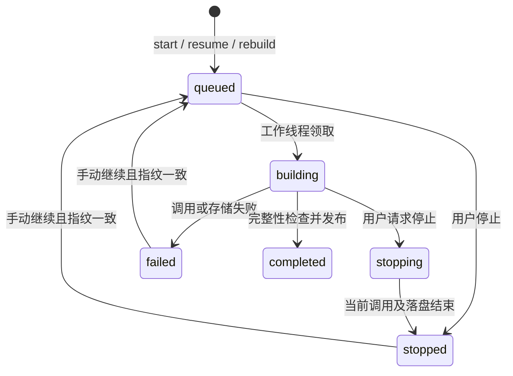

# 小说图知识库技术设计 V1

- 状态：核心功能已实现，真实模型抽取质量待评估。
- 日期：2026-11-18。
- 分支：`feat/novel-knowledge-graph`。
- 需求依据：[小说图知识库需求文档 V1](./novel-knowledge-graph-requirements.md)。

## 1. 设计概要

采用“现有分块 + 大模型抽取 + 保守实体归并 + SQLite 版本化存储 + 有界图遍历”的实现。图谱是小说的派生索引；现有 BM25、Embedding、章节与原文读取继续独立工作。

用户手动启动全书构建，后台按批次保存结果，全部完成后在一个数据库事务中发布新版本。查询不调用模型；重建期间继续查询旧版。Agent 每轮固定图谱版本，图谱结果进入既有证据审查流程。

首版限定单后端进程、单个图谱构建工作线程。不同小说可排队，同一本小说最多有一个未结束的构建任务。图谱构建与现有 Agent、Embedding 构建拥有独立的任务管理，不改变现有 Agent 全局单任务限制。

### 1.1 与现有实现的衔接

| 已有能力 | 设计中的使用方式 |
|---|---|
| `NovelStore` 保存小说、正文哈希并在启动时恢复 | 作为图谱所属小说及正文版本的事实来源 |
| `NovelCorpus` 提供章节、文本块与引文校验 | 抽取输入、证据校验及正文回读，不让模型读取任意文件 |
| `NovelChunk` 保存行号和字符位置，块间可能重叠 | 以正文绝对位置去重，不能以 chunk_id 区分同一处提及 |
| `invoke_structured` 处理结构化输出与格式重试 | 抽取和消歧复用，不另写一套模型响应解析 |
| `model_usage_event` / `add_model_usage` 记录模型用量 | 构建独立统计，不计入某轮 Agent 的消耗 |
| `build_tools`、Assessor 和 Writer | 增加图查询工具；沿用原文校验、步骤预算和最终引用 |
| Vue 工作台及 `api.ts` | 新增知识图谱页面和接口客户端 |

当前 `FlowGraph.vue` 是 Agent 执行流程示意图，不承担实体关系图渲染。

### 1.2 模块职责

新增 `src/novel_agent/corpus/knowledge_graph/` 包，按下列职责拆分：

| 模块 | 职责 |
|---|---|
| `models.py` / `ontology.py` | Pydantic 输入输出、枚举、关系方向和类型约束 |
| `storage.py` | SQLite 表、事务、批次 checkpoint、版本发布和恢复 |
| `extraction.py` / `resolution.py` | 输入窗口、抽取、证据锚定、候选检索与实体归并 |
| `query.py` | 版本只读视图、搜索、邻居、路径及结果预算 |
| `service.py` | 面向 Web 和 Agent 的构建、状态及读会话接口 |

Web 层新增独立图谱路由与任务管理器；不把新任务调度塞进现有 `RunManager`。前端新增 `KnowledgeGraphPanel`、`KnowledgeGraphCanvas` 和 `useKnowledgeGraph`。单元测试镜像上述职责组织。


## 2. 领域模型与关系语义

### 2.1 标识与位置

- `novel_id` 复用现有标识；`graph_version`、`job_id` 使用完整 UUID hex。
- 正式实体 ID 在版本内生成，重建不承诺实体 ID 稳定。所有查询显式携带图谱版本。
- 原文位置沿用 `SourceDocument.text`：字符偏移为 Python Unicode 字符的零基半开区间 `[start_char, end_char)`，不是字节偏移或浏览器 UTF-16 下标；行号从 1 开始，结束行包含在内。
- 证据引文来自保存的原始解码文本，不执行换行替换、标点改写或 Unicode 规范化。前端以服务器返回的引文展示，高亮按 chunk 内文本匹配，不把 Python 偏移直接用于 JavaScript 字符串切片。
- 章节先后以 `document.sections` 的数组位置确定，不比较章节标题或 ID 字符串。

### 2.2 实体与关系词表

实体类型固定为 `person`、`place`、`organization`、`item`、`skill`、`concept`。`concept` 只容纳具有明确名称的专有概念，不收录泛化动词、普通形容词和抽象主题标签。

| 关系代码 | 含义与规范方向 | 合法端点类型 |
|---|---|---|
| `disciple_of` | 弟子 → 师父 | person → person |
| `parent_of` | 父母 → 子女 | person → person |
| `sibling_of` | 兄弟姐妹，对称 | person ↔ person |
| `spouse_of` | 配偶，对称 | person ↔ person |
| `friend_of` | 明确朋友关系，对称 | person ↔ person |
| `knows` | 明确认识，对称 | person ↔ person |
| `cooperates_with` | 合作，对称 | person/organization ↔ person/organization |
| `hostile_to` | 敌对，对称 | person/organization ↔ person/organization |
| `member_of` | 人物 → 所属组织 | person → organization |
| `subordinate_to` | 下属 → 上级 | person → person；organization → organization |
| `located_in` | 实体 → 地点 | 任意类型 → place |
| `possesses` | 持有者 → 物品 | person/organization → item |
| `uses` | 使用者 → 物品或功法 | person/organization → item/skill |
| `part_of` | 部分 → 整体 | place → place；organization → organization；item → item |

“师父收徒”“拜师”等表达统一为 `disciple_of`；不得因同场出现生成 `knows` 或 `friend_of`。没有适当类型的关系候选计入 `unsupported_relation`，首版不使用含义不明确的 `related_to` 兜底。

对称关系按实体 ID 排序存储端点；有向关系按上述语义存储。查询可以双向寻找联系，但 UI 始终保留实际语义方向。

每条关系额外保存：

- `polarity=affirmed|denied`：区分“是师徒”与“并非师徒”。否认陈述保留并显式显示，不能被转换为肯定事实。
- `statement_mode=narration|character_claim`：区分叙述陈述与人物说法。人物说法只表示原文有人如此声称。
- 多组原文依据：组内片段共同支撑同一陈述，组间表示不同出现位置。

推测、疑问、假设、愿望不作为确定关系入库，记录拒绝原因。肯定与否认、叙述与人物说法不互相覆盖；本版不推断哪条最新或最终成立。路径遍历只使用肯定关系，人物说法经过的边必须标记其性质。

## 3. 持久化与版本一致性

### 3.1 文件与连接

数据库位于 `<NOVEL_AGENT_DATA_DIR>/knowledge_graph/graph.sqlite3`，使用 Python 标准库 `sqlite3`，不增加后端数据库服务依赖。所有小说共用一个图谱数据库，通过小说和版本作用域隔离。

连接启用 `foreign_keys=ON`、`journal_mode=WAL`、`synchronous=FULL`、`busy_timeout=5000`。每个执行线程使用自己的连接，不跨线程共享连接；模型调用期间不持有写事务。Web 查询事务只持续一次请求，读视图不长期持有 SQLite 事务。

首版仅支持单后端进程。启动时持有图谱目录的进程锁，使用标准库 `msvcrt`（Windows）或 `fcntl`（POSIX）文件锁，进程退出自动释放；无法获得锁时将图谱子系统标记为 `graph_process_busy`，不启动恢复或构建，其他功能仍可运行。

### 3.2 表与约束

下表列出逻辑字段；JSON 列保存经过 Pydantic 校验的有限结构，不保存供应商原始响应。

| 表 | 关键字段 | 约束与用途 |
|---|---|---|
| `graph_novels` | novel_id PK、active_version、updated_at | 当前已发布版本指针；只能指向该小说的完整版本 |
| `graph_versions` | novel_id、version PK、state、fingerprint、versions_json、model_identity_json、created_at、published_at、counts_json | state 为 staging/published/superseded/invalid；保存本次构建身份 |
| `graph_jobs` | job_id PK、novel_id、version、status、phase、stop_requested、error_code、created_at、updated_at | 排队与恢复状态；同一本书仅一个非终态任务 |
| `graph_units` | version、unit_id、kind、sequence、input_hash、status、result_json、diagnostics_json | 抽取或消歧单位 checkpoint；唯一 `(version, unit_id)` |
| `graph_attempts` | attempt_id PK、version、unit_id、status、usage_json、elapsed_ms、error_code | 每次请求和重试的用量；已发送而结果未落盘的请求标记用量未知 |
| `graph_events` | event_id PK、job_id、version、code、level、phase、unit_id 可空、created_at | 持久化安全诊断事件，状态接口仅返回最近 50 条 |
| `graph_entities` | version、entity_id、type、canonical_name、normalized_name、first_section_order | 主键 `(version, entity_id)`；名称不设唯一约束，允许同名异人 |
| `graph_aliases` | version、entity_id、alias、normalized_alias | 唯一 `(version, entity_id, normalized_alias)`；别名也不跨实体唯一 |
| `graph_mentions` | version、mention_id、entity_id、surface、chunk_id、section_id、section_order、start_char、end_char | 同一绝对位置提及去重；记录真实出现位置 |
| `graph_relations` | version、relation_id、source_id、target_id、relation_type、polarity、statement_mode | 唯一 `(version, source_id, relation_type, target_id, polarity, statement_mode)` |
| `graph_evidence_groups` | version、group_id、relation_id、evidence_hash | 同一关系可有多组证据，按绝对位置片段集合去重 |
| `graph_evidence_spans` | version、group_id、span_index、chunk_id、section_id、section_order、start_char、end_char、start_line、end_line、quote | 主键 `(version, group_id, span_index)`；每个片段独立定位和校验 |

所有实体、关系和证据外键均包含 `version`；版本再绑定 `novel_id`，禁止跨版本或跨书引用。暂存实体未写正式关系前，先完成所有端点映射。自环关系在入库前拒绝。

必要索引：实体 `(version, normalized_name, type)`、别名 `(version, normalized_alias)`、提及 `(version, entity_id, section_order)`、关系的源端/目标端邻接索引、证据 `(version, section_order, group_id)`、任务 `(status, created_at)`。任务使用部分唯一索引限制每书 queued/building/stopping 任务唯一，并限制全库 building/stopping 任务最多一个。

### 3.3 构建指纹与原子发布

`fingerprint = SHA256(规范序列化的构建身份)`，构建身份包含：正文哈希、解析规则版本、章节/分块位置清单哈希、抽取窗口参数、词表/提示词/Schema/消歧版本、模型名称、规范化服务地址、temperature 和 thinking mode。凭据不参与哈希且不保存。显式新增解析与图谱规则版本常量，不把包版本当作规则版本。

发布版本的可读性仅取决于数据库 Schema、正文哈希及章节/分块映射兼容；更换模型、提示词或移除 API Key 不使已有图谱失效。手动继续必须满足完整构建指纹一致；新配置与旧模型构建的图谱可以并存，用户选择重建后才更新图谱。运行时改变同名供应商模型的实际权重无法可靠检测，属于外部服务限制。

构建期间所有结果写入 staging 版本。完成后检查批次均成功、外键完整、每条关系至少一组有效证据、图谱所属正文与当前小说一致。在一个短事务中将新版本设为 published、旧版设为 superseded，并更新 active_version 和任务 completed 状态。

发布前失败或崩溃保持旧指针不变；提交成功即以新版本为准。读取一次请求只解析一次版本。首次构建成功但实体或关系数为零仍可发布空图，并提供诊断统计。

浏览器只允许访问当前 active_version，旧版本请求返回 `graph_version_changed`。Agent 内部读会话允许访问其固定的 superseded 版本。首版保留所有历史版本与 checkpoint，不自动清理；磁盘会随重建次数增长，后续再设计清理策略。

## 4. 构建、抽取与实体归并

### 4.1 后台任务状态机



`phase` 单独表示 extracting/resolving/materializing/publishing。进度分别显示抽取批次完成数与总数、消歧单位完成数与总数，不把模型返回或正在调用的批次计为完成；全流程只有发布完成才显示 100%。抽取批次二分后，以当前叶子单位计算总数，页面注明总数可能调整；消歧阶段开始前固定其单位清单。

启动顺序为：恢复小说 → 获得图谱进程锁与校验数据库 → 对照小说及指纹恢复版本 → 将遗留 queued/building/stopping 任务设为 stopped，错误码 `service_interrupted` → 接受请求。不会在重启后自动发送正文或模型请求。staging 保留以便手动继续；待发布版本不提供查询。

停止在模型请求和数据库事务边界生效；不把 `asyncio.Task.cancel()` 当成已终止后台同步模型调用。工作线程在当前调用结束并保存有效结果后停止，不启动下一单位。最终发布事务前再次检查停止标记；停止与发布在同一锁下决定先后，已发布任务的停止请求幂等返回 completed。

结构化格式错误复用现有重试配置。图谱生成默认最多 6144 输出 token，超时取 180 秒与聊天请求超时的较大值，可通过图谱独立配置覆盖。较大抽取窗口超时自动二分；输出截断后切换精简恢复通道，必要时继续拆分，普通格式最小核心为 500 字，精简恢复最小核心为 200 字。较小窗口及消歧请求超时默认额外重试 1 次，停止标记在重试前再次检查。认证、限流和其他网络异常仍终止任务，保留 checkpoint。模型客户端设置 `max_retries=0`，由应用显式记录各次调用。数据库写锁超时仅重试落盘，不重新调用模型。

输出上限通过客户端参数传递；`finish_reason=length` 或 SDK 长度截断异常不走相同请求的格式重试，而是缩小抽取窗口。响应已返回 usage 时保留截断请求的真实用量；超时未返回 usage 时保留为未知。运行预算不进入构建指纹，既有超时任务继续时标记失败的待处理单位并优先拆分，已完成单位保持不变。

为 `ModelConfig.create_model` 增加可选关键字 `max_retries`，默认不传给客户端以保持现有调用行为；图谱构建显式传 0。抽取和消歧均使用 `with_structured_output(..., method="function_calling", include_raw=True)` 与 `invoke_structured`。实体/关系数量上限由成功解析后的容量检查识别，走窗口二分，不反复当作 JSON 格式错误重试。

### 4.2 抽取窗口与输出

一个现有 Chunk 对应一个抽取单位，按原文顺序处理。输入包含完整核心 Chunk，以及前一块尾部、后一块头部各最多 300 字；相邻块可以跨章节。按绝对位置剔除已有重叠区，再生成上下文，避免把相同原文重复拼接。所有输入片段都带独立 `span_id` 与原文 chunk/section 映射。

核心块沿用当前最多约 2500 字的分块策略；本版不修改小说原有切分。若后续解析产生超大块，则在抽取内部创建最多 2500 字的子窗口，仍映射原 chunk；该切分参数进入指纹。

模型返回 `ExtractionBatch`：

- `entities[]`：局部 ID、类型、正文中的名称、提及锚点、用于消歧的原文短描述。
- `relations[]`：局部实体端点、规范关系类型、polarity、statement_mode、证据片段锚点数组。
- `identity_links[]`：两个局部实体为同一身份的明确依据，例如“甲又名乙”；仍需后续校验。

锚点格式为 `{span_id, quote, occurrence}`；`occurrence` 为该片段中从 1 开始的第几次逐字出现。服务器定位并计算绝对偏移，不相信模型计算的字符位置。名称必须有原文提及；证据每片段最多 600 字，每组最多 3 个片段。至少一个关系证据片段或端点提及落入核心块，否则作为纯上下文重复候选忽略。

每批以 80 个局部实体、120 条关系、40 条身份线索作为密度参考，判断使用校验后的正文候选及去重事实，纯上下文实体与重复项不触发额外拆分。候选密集且窗口仍可拆分时按原文中点附近自然边界二分，普通格式最小核心 500 字；子窗口并集覆盖父窗口并带上下文，父任务完成以全部子任务完成为准。完整响应在最小窗口达到密度参考时，保存全部通过校验的候选并记录容量提示，不丢弃候选或继续无效拆分。空数组是有效输出，不触发重试。响应截断或结构无效仍不能当作完成。

输出截断任务使用 `compact-v1` 精简恢复格式：程序把原文切为不跨 Chunk、每段最多 180 字的证据片段并赋予稳定的局部编号；实体只返回名称、类型和一次提及，关系和身份线索仅返回 evidence_ids，不重复生成引文。程序将这些编号映射回原文，再归一化为同一 ExtractionBatch 并执行既有证据校验。上下文每侧最多 120 字，且随核心长度缩小。单批以 32 实体、48 关系或 12 身份线索为密度参考，满足可拆分条件时继续拆分；恢复通道最小核心为 200 字，达到最小窗口后按上述规则保留有效结果并提示密集。

一旦某次构建发生输出截断，后续未完成单位采用精简格式。已完成的普通格式结果直接复用。每个拆分父单位保存 `split_min_chars`，旧记录缺失时按 500 处理，确保重启时重建同样的子窗口；精简结果记录 extraction_format=compact-v1。恢复策略保持原文身份及归一化结果契约，兼容已有任务，不要求整书重建。

模型响应成功解析为 Schema 后，先以 `extracted` 状态保存格式、原文窗口哈希及候选对象，再执行校验、密度判断和归并准备。继续时验证哈希和 Schema 后复用候选，避免本地处理失败导致重复请求。`extracted` 不计入 completed，也不能发布或检索；状态接口可返回 cached 数量。拆分父单位保存密度计数，完成单位保存核心长度、密度计数及容量提示，便于排查。处理异常使用明确错误码，后台只记录异常类型和调用位置，不输出供应商异常正文、原文或凭据。

### 4.3 原文校验与去重

1. 校验 Schema、片段归属、端点存在、词表和合法类型组合。
2. 在指定输入片段定位引文 occurrence；验证正文 `[start_char:end_char]` 与 quote 完全相等。
3. 将引文归属到包含该区间的真实 Chunk；重叠块同时包含时选择原文顺序最早的块。跨 Chunk 的依据必须分为多个可独立校验的片段，不拼接成不存在的连续引文。
4. 逐片段调用 `NovelCorpus.validate_quote`，并由服务器计算行号。不能锚定的实体提及、身份线索和关系分别拒绝并计数，不伪造证据。
5. 以正文绝对位置与实体类型去重提及，以端点、类型、polarity、statement_mode 去重关系，以排序后的原文片段区间去重证据组。

跨段陈述可以由多个片段共同支撑，但本版不会因“单个片段通过逐字校验”就认定其足以证明整个关系。存在语义误抽的风险，需在真实模型评估中单独统计。

### 4.4 实体归并

先完成全部抽取，再执行全书实体归并，最后生成正式关系。消歧使用与抽取相同的模型配置，不要求 Embedding。

- 同一原文区间、同一类型的提及确定性归并；跨窗口共享提及可连接局部实体。
- 明确别名线索在引文中有两个名称及等同表达，经消歧阶段确认后归并。裸称谓“师父”“他”“陛下”不得成为全书全局别名索引。
- 跨批次按规范名称或已有别名、类型检索最多 5 个候选实体，并附各自最多 2 条、每条不超过 300 字的代表性原文。名称规范化仅用于候选检索，执行 NFKC、首尾空白去除和拉丁字母 casefold，不改写保存的名称与引文。
- 模型对候选返回 merge/new/ambiguous 及输入中的支持锚点。相同姓名、只有一个候选、类型相同均不能单独构成归并依据；需要明确身份线索、共同原文提及或足以区分身份的上下文。
- 候选超过 5 个时优先选择共享出现位置和相近章节的候选，记录 `resolution_candidates_truncated`；不能确认时保留独立实体，而非猜测。
- new 和 ambiguous 都保留独立实体，ambiguous 额外记录诊断。独立实体在页面用类型和首次出现位置区分，不自动给人物改名。
- 每个消歧单位保存候选集合、决定和依据；严格按固定顺序执行，继续任务复用已保存决定，不重新随机归并。对可疑归并宁可多保留一个实体。

正式实体名称取归并集合中最早出现的有效专名，其他经确认的专名进入别名表。实体 ID 由版本与最早提及标识确定性生成；关系 ID 由规范化端点和关系属性生成。新版本重新归并，不沿用旧版实体 ID。

归并注册表可由已完成消歧单位重放恢复，重放不调用模型。materializing 阶段从完整单位结果生成 staging 版本的实体、关系和证据，在一个事务内替换该 staging 版本已有的正式表数据，做到重复执行结果一致；该事务不修改其他版本。事务完成后仍须经过独立发布检查与停止检查。

## 5. 查询设计

### 5.1 共享读服务

`GraphReadSession` 是不持有数据库连接的只读句柄，包含 novel_id、graph_version 和源数据身份。HTTP、Agent 调用同一查询实现，分别应用不同返回预算。

首版采用 SQLite 名称/别名索引及源端、目标端邻接索引按需读取，节点随遍历加载；不需要全图装入内存，也不缓存未带过滤条件的查询结果。邻居请求在节点/边结果上限处停止扩展，路径请求使用独立搜索预算。

每次查询在同一数据库快照内读取所需过滤数据，随后执行有界遍历；版本始终包含在查询条件中。该方案已提供一万节点、五万条边的可复现性能检查脚本；后续只有实测证明需要时再增加内存缓存。

### 5.2 搜索与章节过滤

- 实体搜索排序：规范名称精确匹配 → 别名精确匹配 → 名称前缀 → 名称或别名包含；同级按首次出现位置、entity_id 排序。同一实体命中多个别名只返回一次。
- 输入 q 去除首尾空白，长度 1～200。SQL 参数化，LIKE 中 `%`、`_`、转义符按字面处理。对一万节点规模先采用索引精确匹配和受限 LIKE，不额外引入分词或向量索引。
- 起止章节包含边界。章节 ID 沿用现有 `startChapterId` / `endChapterId` 外部格式 `novel_id:section_id`，验证归属后转换为章节序号。
- 一组关系证据中的所有片段都落在范围内时，该组才有效；至少存在一组有效证据的关系才进入本次结果。多片段联合证据不能只保留其中一段而继续使用整个陈述。
- 搜索和详情中的出现位置、证据数量均按当前范围计算。若有效关系的某个实体仅在范围外有独立提及，仍允许显示为关系端点，但不附带范围外提及和证据。
- 类型与章节过滤在遍历前应用。根实体及路径两端可保留为锚点，中间节点必须满足实体类型过滤；不允许先穿过被过滤的节点再隐藏它们。

### 5.3 邻居与路径

邻居查询默认一跳、最多三跳，按无向连通展开，同时返回真实 source/target 和关系方向；包含肯定与否认关系，否认边使用不同样式并明确为陈述。层内按端点首次出现位置、relation_id 排序，结果确定性截断。

路径查询只使用 affirmed 关系，按无向关联查询最短路径，默认最多三跳、五条。采用分层 BFS，路径内禁止重复节点；不能用全局 visited 丢掉通向同一节点的其他同长路径。发现最短长度后只枚举该长度的路径；达到五条后停止并报告是否可能存在更多路径。相同实体序列下的不同关系边属于不同路径。from 与 to 相同返回一个零跳路径。

每个请求最多检查 50000 条候选边、扩展 20000 个路径状态、运行 2 秒，均由查询服务强制执行。邻居返回最多 100 个节点、200 条边；插入边前先检查其端点预算，不返回悬空边。路径结果最多 5 条、每条 3 条边。

响应区分：

- `truncated`：结果数量或搜索预算达到上限。
- `truncation_reason`：node_limit/edge_limit/path_limit/search_budget/output_budget。
- `search_complete`：是否穷尽本次范围内所需搜索。只有 complete 且路径为空才表示限定条件内未找到；预算耗尽时提示检索未完成。

有限跳数、否认边不参与路径、自动归并失败和抽取遗漏都可能造成无路径，不能解释为小说中不存在联系。

## 6. HTTP 接口与类型契约

统一前缀 `/api/novels/{novel_id}/graph`。新增图谱路由，旧搜索接口及其返回类型不变。请求 Schema 使用 Pydantic 严格校验，枚举非法或范围越界返回 422，跨书章节及反向章节范围返回 400。

| 方法与路径 | 请求 | 成功响应 |
|---|---|---|
| `GET /status` | 无 | 200：可用性、当前版本、构建任务、模型及文本规模 |
| `POST /builds` | `{mode: start\|resume\|rebuild}`；resume 必填 job_id，其他模式不允许传入 | 202：job_id、目标版本及状态；已完成缓存命中为 200 |
| `POST /builds/{job_id}/stop` | 无 | 200：任务当前状态和 stop_requested |
| `GET /entities` | q、type 可选、offset=0、limit=20，最大 100 | 200：实体分页与匹配方式 |
| `GET /entities/{entity_id}` | version、章节范围、offset=0、limit=20，最大 100 | 200：实体、别名、分页提及和范围内统计 |
| `GET /neighbors` | entity_id、depth=1（1～3）、重复 entity_type/relation_type、章节范围 | 200：nodes、edges、evidence 及截断信息 |
| `GET /paths` | from_id、to_id、max_hops=3（1～3）、limit=5（1～5）、类型与章节范围 | 200：paths、nodes、edges、evidence 及截断信息 |
| `GET /relations/{relation_id}/evidence` | version、章节范围、offset=0、limit=20，最大 100 | 200：分页证据组，组内片段不可拆页 |

所有读取图内容的接口都必须传 `version`；status 和构建接口不需要。entities 搜索也使用 version 和相同章节范围参数。默认每条返回边内联最早的 1 组有效证据，其余通过证据分页接口读取；返回 `evidence_total` 避免让一条样本看起来就是全部依据。

start 在无完整同指纹图谱时创建任务；已有完整同指纹版本时直接返回缓存状态。存在可继续的失败/停止任务时返回 `graph_resume_required`，由用户选择继续或重建。resume 要求任务属于当前小说、处于 failed/stopped 且指纹相同；rebuild 创建新 staging 版本并重新抽取，不删除旧版。

同一小说已存在 queued/building/stopping 任务时，start/rebuild 返回该任务而不重复入队；resume 传入另一 job_id 时返回冲突。stop 重复调用或任务已结束时返回现状；不存在的任务返回 404。

### 6.1 公共数据类型

```typescript
type GraphStatus = {
  available: boolean
  active_version: string | null
  error_code: string | null
  configured: boolean
  model_name: string | null
  source_characters: number
  estimated_extraction_units: number
  job: GraphJob | null
}

type GraphJob = {
  job_id: string
  graph_version: string
  status: 'queued' | 'building' | 'stopping' | 'completed' | 'failed' | 'stopped'
  phase: 'extracting' | 'resolving' | 'materializing' | 'publishing'
  stop_requested: boolean
  extraction: { completed: number; total: number }
  resolution: { completed: number; total: number }
  entity_count: number
  relation_count: number
  elapsed_seconds: number
  usage: {
    request_count: number
    reported_input_tokens: number
    reported_output_tokens: number
    unknown_request_count: number
    failed_request_count: number
  }
  can_resume: boolean
  error_code: string | null
}

type GraphEvidenceSpan = {
  chunk_id: string
  section_id: string
  section_title: string | null
  start_char: number
  end_char: number
  start_line: number
  end_line: number
  quote: string
}

type GraphQueryMeta = {
  graph_version: string
  truncated: boolean
  truncation_reason: string | null
  search_complete: boolean
}
```

节点包含 id/name/type/aliases/match_kind（搜索时）；关系包含 id/source/target/type/polarity/statement_mode/evidence_total/evidence_groups。路径以有序 node_ids/edge_ids 返回，不能要求前端根据节点列表重新猜测路径。分页响应包含 items/offset/limit/total；查询元数据使用 GraphQueryMeta。

模型用量中的 reported 值是已报告请求的小计，unknown_request_count 大于零时 UI 必须显示“部分用量未知”，不把零解释为未消耗。构建累计用量包括失败、格式重试与消歧请求，继续任务不清零。

### 6.2 错误与降级

错误格式沿用现有客户端的字符串 detail，并新增 code：`{"detail":"图谱已更新，请刷新。","code":"graph_version_changed"}`。`api.ts` 的 ApiError 增加可选 code，旧接口不提供 code 时保持现有行为。

| HTTP | code | 处理 |
|---|---|---|
| 404 | novel_not_found / graph_object_not_found | 不存在或不属于该小说，不泄露其他书对象 |
| 409 | graph_not_ready / graph_version_changed | 尚未发布或版本已更新，提示构建或刷新 |
| 409 | graph_resume_required / graph_fingerprint_changed / graph_job_conflict | 继续或重建决策，不混用 checkpoint |
| 409 | graph_model_not_configured | 缺少模型配置时不能开始构建；已有有效图仍可查询 |
| 503 | graph_storage_unavailable / graph_process_busy | 仅图谱子系统不可用，允许原有功能继续 |

供应商异常只返回安全错误码和说明，不包含凭据、原始响应或异常正文。本文所有新增对外 DTO 均由白名单字段生成，不直接序列化数据库行。

## 7. Agent 集成与证据边界

### 7.1 读会话与工具

`create_app` 注入图谱服务给 `RunManager`。在创建每轮 RunRecord 时捕获当前 GraphReadSession 或 None；给 `execute_agent` 与 `build_tools` 增加可选 `graph_reader=None` 参数。图谱版本在 RunRecord 中保留，手动重试使用同一会话；没有图谱时仍能按原有签名默认值运行。

只有会话存在时注册以下工具；运行期间新图谱发布不改变本轮工具集：

| 工具 | 参数及限制 |
|---|---|
| `search_graph_entities` | query、entity_type 可选、top_k 默认 5 最大 8、章节范围可选 |
| `get_graph_relations` | entity_id、depth 默认 1 最大 2、关系/实体类型与章节范围可选；最多 20 节点、20 边 |
| `find_graph_paths` | from_id、to_id、max_hops 默认 3 最大 3、类型与章节范围可选；最多 3 条路径 |

工具不暴露 novel_id 或版本选择参数，由读会话限定。Agent 范围参数使用 corpus 内部 section_id；Web 外部 chapter_id 在路由层转换，两者共享同一个范围解析器。

每条边默认提供一组完整证据。工具返回 JSON 总量最多 12000 字符；按完整边/完整路径移除低优先级项以满足预算，不能截断 JSON 或把引文截成不真实文本，metadata 不计为空结果。已移除项以 output_budget 标记。需要更多上下文时继续调用已有 read_context/read_section。

### 7.2 证据进入既有流程

图工具将每个证据片段输出为带 chunk_id、quote、真实行号及章节的原文材料，明确 quote 即可引用的原文。更新 Assessor 提示词以识别这类材料，仍由模型提出 Evidence，再执行现有 `validate_quote`。

跨块依据由多个短引文组成时分别产生 Evidence，解释应说明共同支撑的关系，不能伪造一个跨块引文。现有每轮最多 3 条、每任务最多 6 条证据预算保持不变；若预算不足，最终答案披露限制。

Researcher 提示词加入“先消歧再查询关系”“多跳仅为联系线索”“否认及人物说法不能写成已确认事实”“无路径优先改用文本检索”。图查询异常通过 `_safe_tool` 的兼容错误对象返回，引导使用原有工具，不直接使整轮问答失败。

新增可选 `graph_version` 到 Agent 状态与公共快照；Assessor 的工具历史增加图谱版本及截断标记，`event_detail` 在 tools 事件中输出有界的图查询摘要。保留原有工具调用指纹算法和步骤计数，不额外增加 Agent 状态图节点。

对旧会话快照缺失 graph_version 的情况按 None 读取。构建消耗与 Agent 消耗分开显示；不要求用户将图谱重建才能继续对话。

## 8. 前端交互设计

- 在“智能分析 / 结构概览 / 文本检索”后增加“知识图谱”，按当前选中的小说加载。
- 顶部状态卡显示可用版本、模型、原文字符规模、构建进度、实体/关系数、用量、停止或继续按钮。首次构建和重建按钮旁明确说明会向配置的模型服务发送正文，不新增第二次权限确认弹窗。
- 任务运行时每 1500ms 轮询 status；停止或完成后停止轮询，保留最后状态。离开页面和切书时清理定时器、AbortController 与图实例。
- 实体输入框使用 300ms 防抖，候选显示名称、类型与首次出现位置。选定一个实体展开一跳；选定第二个实体后可执行路径查询。
- 章节选择复用现有搜索面板的章节分页加载与范围校验；提交过滤后丢弃旧图和证据，按当前固定 version 重新查询。
- 使用新增依赖 Cytoscape.js 及其 TypeScript 类型包 `@types/cytoscape` 渲染关系图；组件动态导入，避免增加默认 Agent 页面首屏负担。使用内置 cose 布局和确定的节点初始位置，仅在首次查询或用户重置时重排；扩展时保留已有节点位置。
- 实体颜色区分类型，有向边显示箭头，对称边无箭头；denied 使用虚线及“否认”文字，character_claim 显示“人物说法”。不只用颜色表达含义。
- 右侧/窄屏下方显示键盘可访问的结果列表与证据面板，复用原文回读接口。现有上下文可包含范围外邻接段，点击展开时标明“展开原文上下文”；初始证据结果严格按章节范围过滤。
- API 返回 graph_version_changed 时清空旧节点选择并重新取 status，提示图谱已更新，不自动用旧实体 ID 请求新版本。
- 展示“自动抽取”“当前章节范围”“结果已截断/检索未完成”和空图状态；不展示模型推理过程、SQL 或内部消歧结构。

## 9. 可靠性、可观测性与兼容

- 单位结果、实体映射及完成标记在同一事务提交，避免“进度已完成但结果未保存”。客户端请求发送前落盘 attempt started；重启时未结束的 attempt 记 interrupted/unknown，不能声称模型端没有发生费用。
- 恢复时验证数据库 quick_check、外键与版本身份；发布前验证所有正式证据锚点。发现来源不匹配将该版本设为 invalid；SQLite 损坏无法局部读取时整个图谱子系统 unavailable，小说、Embedding 和对话照常恢复。
- 损坏数据库在所有连接和工作线程关闭后才可隔离；不在仍被占用的 Windows 文件上执行替换。首版向用户报告重建要求，不自动删除损坏数据。
- 写入失败会保留旧 active_version；checkpoint 已保存的批次可继续。图谱 unavailable 不触发重建，不启动付费请求。
- 标准日志仅记录 job_id/version、阶段、单位序号、用量和安全错误码。抽取请求正文及原始模型响应不写日志；有效引文和经过校验的结构化候选保存在本地数据库。
- 状态诊断区提供拒绝证据数、拒绝关系数、待消歧/未合并数、重试数和最近 50 条安全事件；完整批次记录从本地数据库排查。
- 数据根目录沿用 NOVEL_AGENT_DATA_DIR；备份继续采用停止服务后整体复制数据目录，包含 SQLite 及其可能存在的 WAL/SHM 文件。旧小说没有图谱记录时按未构建处理，不变更小说 Manifest 格式。
- 数据库使用 user_version 管理 Schema。首版新建为 1；未知较新版本只禁用图谱并提示升级，不自行破坏性迁移。

## 10. 测试与实施顺序

### 10.1 自动化测试

| 层级 | 必测内容 |
|---|---|
| 原文与抽取 | 重叠块、跨块/跨章片段、重复引文 occurrence、CRLF、中文及非 BMP 字符、伪造位置、超大输出二分、空抽取 |
| 消歧 | 明确别名、同名异人、含糊称谓、候选截断、证据不足保留分裂、checkpoint 复用、恢复后 ID 一致 |
| 存储与任务 | 排队/重复提交、停止边界、格式重试、供应商失败、用量未知、事务中断、服务重启、指纹变化、发布原子性、只读旧版会话 |
| 查询 | 搜索排序、LIKE 字面匹配、方向和对称边、否认不参与路径、环、多条同长最短路径、零跳、过滤前遍历、联合证据范围、预算截断、无悬空边 |
| API | 全部状态码、对象/章节跨书校验、旧版本 409、证据整组分页、敏感字段不返回、缓存命中无模型请求 |
| Agent | 三类工具、版本固定及重试、有效引文进入 Evidence、假引文拒绝、跨块证据分别校验、图故障改用文本检索、原预算不变 |
| 前端 | 轮询清理、切书并发响应丢弃、重名选择、构建与旧图并存、版本失效刷新、过滤/截断/空态、列表可访问性 |

后端测试注入模型工厂、可控时钟和临时数据库；复用现有 FastAPI TestClient 与脚本模型模式。前端 Vitest 测试对图渲染库使用适配器 mock，验证用户行为与结果，避免断言布局坐标。

### 10.2 质量与性能验证

- 人工编写不少于 20 个归并案例、30 条标注关系，记录实体归并错误、实体分裂、关系准确率和召回率；分别报告肯定、否认、人物说法和跨块案例。
- 自动化测试通过不能替代真实模型质量评估。模型试验显式由用户启动，记录模型、提示词版本、文本规模、token、请求次数与总耗时。
- 生成一万节点、五万边数据，加入高连接度节点、多别名、无路径与多路径案例。预热后每类至少 100 次查询，报告 P50/P95、冷加载耗时、内存、截断率及硬件配置。
- 验收实体搜索/一跳查询 P95 ≤ 1 秒，三跳查询 P95 ≤ 3 秒；预算截断返回也计入统计，单独报告 search_complete 比例，不能靠全部提前截断掩盖性能问题。
- 回归命令为 `python -X utf8 -m pytest`，前端目录下 `npm test` 和 `npm run build`。性能使用独立合成数据脚本检查；真实模型质量评估需显式添加 `--run-model`，默认不触发付费请求。

### 10.3 开发拆分

1. 领域词表、SQLite、指纹、版本发布和恢复；以固定候选数据贯通存取。
2. 抽取窗口、证据定位、实体归并、任务调度与构建状态；以脚本模型验证全流程。
3. 实体/邻居/路径共享查询与 HTTP 接口，补齐隔离、过滤和预算测试。
4. Agent 读会话、三个工具、证据适配及持久化可观测字段，完成原问答回归。
5. 图谱页面、图渲染与交互状态，完成前后端集成和性能、真实模型评估。

## 11. 已知限制

- 原文逐字校验不等于语义事实正确；本版用明确来源和保守归并降低错误影响。
- 同名实体消歧依赖上下文和模型，可能保留重复实体；不承诺全书身份完整统一。
- 章节筛选不是剧情时间线；别名可能包含后文信息，不提供无剧透保证。
- 三跳有界查询不能替代任意深度图查询；高连接度数据可能返回截断结果。
- 首版未提供人工纠错、跨书查询、社区摘要、Neo4j 适配及历史数据清理。
- 核心功能的自动化验证使用脚本模型与合成图；真实模型抽取质量和实际小说构建消耗不由这些检查证明。
